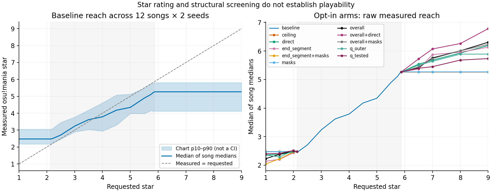
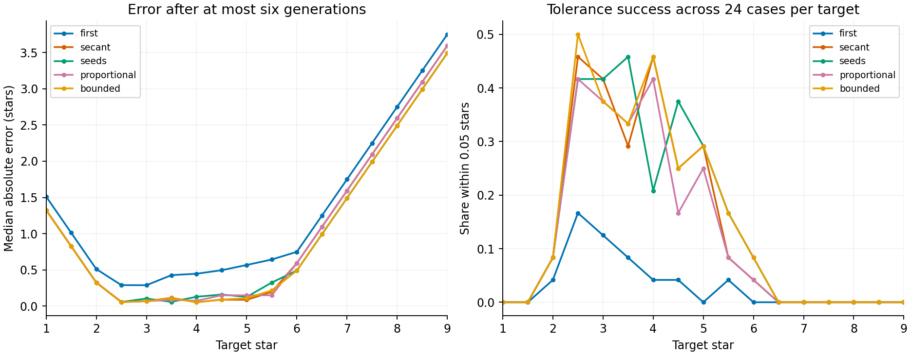

# R2 star reach and target-search experiment — 2026-11-10

**Result:** no experimental lever qualifies for a default change. Baseline
plateau centres are 2.477 and 5.266 measured stars. A search restricted to
R2's effective request interval modestly improves error at the same maximum
six generations, but does not make the 1–9 target range achievable.
These are measured ratings and structural screens; nobody played the charts.

[Interpretation and recommendation](#results-and-interpretation) ·
[Q1 tables](#q1-baseline-measurements) ·
[Q2 tables](#q2-arms-and-structural-references) ·
[Q3 tables](#q3-client-side-search) ·
[Private evidence paths](#private-evidence-on-the-mac)

## Decision rules (preregistered; do not rewrite after observing arms)

Started 11:24 UTC; stop about 13:54 UTC (2.5 hours). Baseline source is
`edf4066`; the first, isolated commit `4c94563` accepts finite whole-song and
section stars and clamps the prior band to 2–5. No other defaults change.
This is a study of **measured star and structural warning signs**, not
playability: nobody will play these charts. All conclusions carry that limit.

**Measurement.** Use `compute_mania_star_rating_20241007(objects, 4, 1.0)`
from ensomi-model tag `r2-1.0.1` (`885bb74c19bd68d1c77087d3ec8746244196daa5`),
loaded directly from the pinned file. Before arms, check the four published
examples against the reported rounded ratings (4.63, 3.57, 2.73, 3.19), and
check the structural metrics on hand-constructed charts. Runtime `r` is
reported separately, never used as a proxy for star.

**Sampling fixed before generation.** Four published songs: Adventure,
Catch the Moment, Hesitation Snow, Saigetsu. Eight distinct held-out audio
recordings from `data/r2-corpus.parquet`: `eval_split == heldout`, audio
present on disk, positive finite dominant BPM and note density, annotated
span 45–300 seconds. Deduplicate by audio SHA-256 (lexicographically first
chart path). Use percentile ranks of dominant BPM, annotated duration and
(notes / annotated second), start at the lowest BPM, then greedily maximize
minimum Euclidean distance to selected points, with path as tie breaker.
This spreads metadata, not generated outcomes; it is not a population-random
sample. Freeze the private manifest before any generation. Use seeds 0 and
1000, paired in every arm. No song exclusions based on generated output.

**Q1.** Requests 1–9 by 0.5 plus 1.875, 2.0, 2.0625, 2.125, 2.1875,
5.75, 5.8125, 5.875, 5.9375, 6.0, 6.125. Report median, p10–p90 and
min–max across song/seed charts, song medians, within-song absolute
seed-pair difference, in-table OLS slope and signed bias. The null spread
at an end is the median across songs of `abs(star(seed0)-star(seed1000))`
at request 2.0 or 5.875. Also report p90 of those differences. Plateaus
require equal hit objects for every paired song and seed, not just equal
rounded ratings. `.osu` metadata is not a difficulty measurement.

**Q2 arms.** Keep baseline masks unless the other levers fail the proposal
rule. Test rows linear extrapolation with the overall slope and each end
segment's slope; initially restrict log workload to [0, 6] as a numerical
exploration bound, not a supported domain. Test quantiles (low/high pairs)
0.1/0.75 and 0/0.95; the latter is outside the receipt's tested [0.1, 0.75].
Test multiplier ceiling 1.3 (within the fit's [0.8,1.3]) alone, and direct
multipliers 0.8/1.3 to separate a clipped quantile from the head-count lever.
The default lower bound is already 0.8. At minimum test 1, 1.5, 2,
5.875, 6.5, 7, 8, 9; add the Q1 request grid for any proposed curve.
Quantile and multiplier changes ramp linearly from their baseline value at
2.125/5.875 to their arm's endpoint at 1/9, then clamp. They therefore leave
the fitted interval unchanged. Combine the rows arm with the largest
correct-direction endpoint median movement with the best of the non-rows
arms, if each moves the endpoint by at least one null spread. If no such
combination, report that. Ties choose overall slope, then tested quantile,
then fit ceiling, then direct multiplier, then untested quantile.

If these stall, one final, explicitly unsupported mask arm may ramp the
reattack floor to 200 ms at 1 and 50 ms at 9, with high-end quad-run cap 2;
compare it alone and with the best rows arm. These are invented limits,
not fitted evidence of playability. No other levers without a dated,
pre-run amendment explaining them.

**Structural envelope fixed from baseline fitted edges.** For each song,
reference all four charts (2 requests × 2 seeds) at 2.0 and 5.875. Every
candidate at a proposed end must satisfy all following per-chart bounds;
no averaging hides a failed song. These are conservative screening rules,
not a validated playability classifier. Numerical values will be filled
from baseline before evaluating arms; formulas will not change.

| Indicator | Allowed envelope, using that song's edge minimum L and maximum H |
| --- | --- |
| Generation/export | succeeds, legal chart, at least 2 head rows, all 4 lanes used |
| Fallbacks per 1,000 head rows | <= max(5, 2H) |
| Beats without a head row | <= min(1, H + 0.15) |
| Notes per whole audio second | [0.5L, 1.5H] |
| Head rows with 3 notes; with 4 notes (separately) | <= min(1, H + 0.10) |
| Long-note heads / notes | [max(0, L - 0.10), min(1, H + 0.10)] |
| Shortest same-lane head-to-head reattack | >= max(50 ms, 0.8L) |
| Largest lane's share of notes | <= max(0.45, H + 0.10) |
| Longest head-free gap, including song ends, in grid beats | <= max(8, 2H) |
| Fit-domain and fallback support | multiplier within [0.8,1.3]; no selected fit `fallback_ok: false` |

Report clamp, above/below-tested-q and fit fallback flags separately;
clamping and untested q alone do not prove degeneration. A receipt's
`per_m` entries describe calibration points, not observations on this chart.
Inspect the selected multiplier's support rather than rejecting all charts
because a distant calibration entry failed.

**Proposal gate, separately per end.** Across the full tested extended
range, the median of the 12 song medians (each over two seeds) must be
non-decreasing with request (allow only 1e-9 arithmetic noise). At the end,
the paired median movement from the baseline plateau must exceed twice
the baseline null spread and be at least 0.5 stars. Every candidate must
stay in the structural envelope. Failure of any clause means no proposed
default. Report signed effects, failures and raw reach even when rejected.
Choose a cap as the furthest contiguous request from the fitted edge
satisfying monotonicity and structural bounds, before a reversal or failure;
never hide the uncapped observations. A capped curve must itself meet the
0.5-star and twice-spread gate. No extrapolation beyond the tested cap.
A surviving proposal gets a separate last commit enabling it only outside
[2.125,5.875], with byte parity inside that interval. If none survives,
leave all experimental options off by default.

**Q3.** Implement the requester's algorithm literally: N=6, tolerance=0.05,
saturation delta=0.01, slope clamped to [0.5,2], request bounded to T±3,
earliest winner on ties. Targets 1–9 by 0.5; seeds 0 and 1000. Compare
six seeds at fixed request and a proportional-step variant of the same
algorithm omitting secant slope. Identical candidates may be cached, but
count logical generations, not cache misses. All methods keep the best,
so returned error must never exceed first-try error. Report error median,
p90, shares <=0.05 and <=0.15, generations and saturation, per target and
pooled. Stratify interior and out-of-reach targets; pooled improvement
alone cannot justify steering. A different rule is a recommendation only
if its paired median error and p90 are no worse, at least one improves,
and mean logical budget is no greater; otherwise state the tradeoff.
No tuning on this sample presented as an independent validation.

## Method and provenance

The preregistration above was committed as `7f429ef`, before generating any
charts. A final proposed curve must also be non-decreasing on the unchanged
in-table baseline points; the per-end tables below are screening tests, not
a waiver of the full-curve gate. This clarification was written before any
lever arms ran.

The frozen manifest SHA-256 is
`49e43483dfeb4f5a011d0a1c97dbe51e5146d9b09ec725b0ca1fbe117ca28662`.
Selection found 467 eligible distinct held-out recordings and chose eight
with eight distinct corpus group IDs and artist/title pairs. Their source annotations span
58–270 BPM, 54.473–267.555 seconds and 1.445–26.047 notes/second. These are
selection metadata, not output measurements. The actual twelve full audio
recordings span 60.0–273.9 seconds. No cropping or post-generation selection.
No per-song table from the private corpus is included here.

The four published inputs use the recorded float64 PCM, channels averaged
in float64 then rounded to mono float32, at each recording's rate. Held-out
audio is decoded by ffmpeg to mono float32 at 44100 Hz. The native public
`prepare` API runs once per song; its `Prepared` bytes are reused by
`generate_prepared`. Every candidate uses one arrangement pass, default
natural long notes, no sections or pattern requests. CPU ONNX Runtime runs
the chart graphs on one intra-op thread; BeatThis uses the performance
cores during preparation. Device: Apple M5, 24 GiB RAM, macOS 27.0.
Concurrent jobs make these timings unsuitable as standalone latency claims.

The pinned calculator reproduces the published examples:
Adventure 4.6336314444, Catch the Moment 3.5713266497,
Hesitation Snow 2.7325226611, Saigetsu 3.1917039504.
These are consistency checks against known outputs, not human validation
of star as perceived difficulty. Hand-counted checks cover chords, LN
share, reattacks, empty beats, lane collapse, rounded beat boundaries and
a fractional multi-segment grid. The envelope has no human-labelled
validation: passing it only means no listed warning exceeded its bound.

Head rows mean distinct exported head timestamps; chord size counts heads,
not held lanes. LN share counts LN heads among all notes. Reattack means
head-to-head in one lane. NPS divides by the entire audio duration, including
silence. Empty beats use the rows model's whole-beat grid and include partial
edge beats; a 0.501 ms allowance assigns rounded heads to their intended
beat. Longest head-free gap includes both song ends. These definitions can
characterize a chart's structure but cannot judge its musicality.

Builds:

| Purpose | Source |
| --- | --- |
| Start | `edf4066` (`origin/main` at job start) |
| Only product behaviour change | `4c94563`: finite stars, band clamped to 2–5 |
| Baseline worker | `5ed87d8`, with the core exactly at `4c94563` |
| Opt-in lever worker | `d663b6b` |
| Measurement writer fix / aggregation | `4a84b0d` |
| Search plateau memoization | `fe64a94` |
| Numerical envelope frozen before arms | `e62e713` |
| Exact q=0.1 endpoint | `64b305e`; 24 rerun charts/ratings identical |
| Bounded-search amendment / implementation | `04cde69` / `6269336` |
| Combination selected after complete single arms | `622ea2f` |
| Mask arms authorized after combination failed | `d33da16` |

The first baseline attempt exposed a Python result-writing collision between
requested and measured `star`; it stopped before producing any sweep table.
`4a84b0d` separates those fields, and the baseline sweep was restarted. No
arms or selection decisions used that failed attempt. `builds.json` in the
private directory records binary and runtime-config SHA-256 hashes.

Code reading confirms the supplied mechanism: clamped 16-point rows
workload table, band-only priors/masks/quantiles, fitted multiplier clipped
to [0.8,1.2], zero R2 conditions, and seeds `s` / `s+954` (low 32 bits).
The overall rows slope is 0.4999019906 log-workload/star; end slopes are
0.7929525934 below and 0.4829161723 above. The multiplier lower bound is
already 0.8; `direct` explicitly blends the chosen multiplier toward 0.8
or 1.3 to measure the head-count lever without a quantile/clamp confound.
For `direct`, the receipt’s `domain` and `clamped` describe the raw fit
solution before that explicit blend; `m_final` records the resulting
multiplier, checked against the fit’s full [0.8,1.3] domain.
`ceiling` only raises the allowed upper edge. The model's calibration
`per_m` says fallback support holds through 1.3 and fails from 1.45; this
experiment never requests a multiplier outside [0.8,1.3]. The receipt
contains `clamped` and `above_tested_band`, but does not carry `per_m`;
that support statement comes from the package, not each generated chart.

The requested cross-repository sweep found the old range in the model
README, released-system report/Python entry point, runtime validation and
capabilities metadata, and the Hub card. No applicable range contract was
found in the protocol or beatmap-lens. The separate `codex/star-open` job
owns the product's metadata/UI/documentation rollout. This experiment
changes no client pin, model file, release, tag, or published card.
The runtime and model sources are respectively
[the starting pipeline](https://github.com/ensomi-labs/runtime/blob/edf4066/crates/generate/src/generate.rs)
and [the pinned calculator](https://github.com/ensomi-labs/ensomi-model/blob/r2-1.0.1/src/ensomi_model/osu_core/difficulty.py).

## Reproduction

From the repository root. `select` needs numpy and pyarrow (available in the
model checkout's venv); plotting needs matplotlib. Generation, measurement,
search and aggregation otherwise use the Python standard library. ffmpeg
is needed to decode the private audio.
`select` refuses to overwrite its frozen manifest. Use a fresh private
output directory for a new sample. Reuse this run's manifest/prepared files
to reproduce these exact songs. Do not put that directory inside this public
repository. Build the baseline at `5ed87d8` in a separate worktree to compare
with the saved experiment build; both binaries must use the same model.

```sh
MODEL="$HOME/ensomi/ensomi-model"
OUT="$MODEL/artifacts/star-reach-20261110"
# Use a fresh OUT for a new run; select refuses an existing manifest.
BASE="$PWD/target/star-reach-baseline-src"
git worktree add --detach "$BASE" 5ed87d8
CARGO_TARGET_DIR="$PWD/target" cargo build --locked --release --manifest-path "$BASE/Cargo.toml" -p ensomi-generate-ort --example star-reach
cp target/release/examples/star-reach target/star-reach-baseline
git worktree remove "$BASE"
cargo build --locked --release -p ensomi-generate-ort --example star-reach
cp target/release/examples/star-reach target/star-reach-arms
"$MODEL/.venv/bin/python" artifacts/star-reach/run.py select --model-repo "$MODEL" --private "$OUT"
python3 artifacts/star-reach/run.py validate --model-repo "$MODEL" --private "$OUT"
python3 artifacts/star-reach/run.py prepare --model-repo "$MODEL" --private "$OUT" --binary target/star-reach-baseline
python3 artifacts/star-reach/run.py sweep --model-repo "$MODEL" --private "$OUT" --binary target/star-reach-baseline --run baseline
python3 artifacts/star-reach/analyze.py --private "$OUT" --freeze-envelope
python3 artifacts/star-reach/run.py sweep --model-repo "$MODEL" --private "$OUT" --binary target/star-reach-arms --run single-arms --arms overall,end_segment,q_tested,q_outer,ceiling,direct
# These follow-ups were selected by the preregistered rule, in this order.
python3 artifacts/star-reach/run.py sweep --model-repo "$MODEL" --private "$OUT" --binary target/star-reach-arms --run combined --arms overall+direct --requests 5.875,6.5,7,8,9
python3 artifacts/star-reach/run.py sweep --model-repo "$MODEL" --private "$OUT" --binary target/star-reach-arms --run masks --arms masks
python3 artifacts/star-reach/run.py sweep --model-repo "$MODEL" --private "$OUT" --binary target/star-reach-arms --run masks-low --arms end_segment+masks --requests 1,1.5,2,2.125
python3 artifacts/star-reach/run.py sweep --model-repo "$MODEL" --private "$OUT" --binary target/star-reach-arms --run masks-high --arms overall+masks --requests 5.875,6.5,7,8,9
python3 artifacts/star-reach/run.py search --model-repo "$MODEL" --private "$OUT" --binary target/star-reach-baseline --run baseline --cache-baseline-plateaus
python3 artifacts/star-reach/run.py search --model-repo "$MODEL" --private "$OUT" --binary target/star-reach-baseline --run bounded --rules bounded --cache-baseline-plateaus
python3 artifacts/star-reach/parity.py --model-repo "$MODEL" --private "$OUT" --binary target/star-reach-arms
python3 artifacts/star-reach/analyze.py --private "$OUT"
python3 artifacts/star-reach/diagnostics.py --private "$OUT"
python3 artifacts/star-reach/audit.py --private "$OUT"
"$MODEL/.venv/bin/python" artifacts/star-reach/plot.py
python3 -m unittest discover -s artifacts/star-reach -p 'test_*.py'
cargo clippy --locked --workspace --all-targets -- -D warnings
cargo test --locked --workspace
cargo run --locked --release -p ensomi-generate-ort --bin parity -- --model-dir "$MODEL/artifacts/release-r2/bulk/hf/ensomi-r2" --reference "$MODEL/artifacts/runtime-ref" --assets assets/resampler --out "$OUT/native-parity.json"
```

`--assets`, `--onnx`, `--jobs`, `--songs`, `--arms`, `--requests`,
`--rules`, `--search-arm` and `--full-grid` are
explicit driver arguments. The search's plateau cache is allowed only after
the complete Q1 sweep proves equal hit objects at each end. It canonicalizes
those requests to 2.125 or 5.875 while preserving the literal requests and
the actual number of logical generations in search traces. It is a computation shortcut,
not a changed search rule. Controls are unchanged throughout.

## Additional search comparison (committed before its runs)

After Q1 established exact endpoint equality, add one model-aware search
rule, `bounded`: initialize `r = clamp(T, 2.125, 5.875)` and clamp every
secant update to that same interval instead of `T ± 3`. All other logic,
including N=6, tol=0.05, slope bounds [0.5,2], saturation delta 0.01,
seed increments and earliest ties, stays unchanged. Its first chart must
match the original algorithm's first chart. The bounds come from the model
table and Q1 equality, not tuning search errors. This tests the specific
hypothesis that avoiding known-equivalent requests saves a useful try.
The original three algorithms remain required comparisons. Judge this
follow-up by the same median-error, p90 and mean-generation gate. It uses
the same panel and therefore requires independent replication before a
population claim; it is not a new held-out validation set.

## Results and interpretation

All planned baseline points, six single arms, the selected combination,
conditional masks, and four search rules completed by 12:20 UTC, within
56 minutes of the 11:24 UTC start. Analysis and checks followed within
the 2.5-hour time box.
There are 624 Q1 records, 1,848 Q2 records (including shared reference
anchors), and 1,632 Q3 episodes with 9,321 logical generations. Caching
reuses identical candidates; 3,984 successful candidate records were stored
and audited. The 24 corrected q=0.1 records replace their numerically
rounded predecessors in the arm tables; their charts and ratings agree.
Every request/arm point has 12 songs × two seeds. Every search rule has
408 target/song/starting-seed cases.

### Today's measured reach

The hit objects are exactly identical for each song and seed at every
sampled request <=2.125, and likewise at every sampled request >=5.875.
The plateau centres are **2.477 and 5.266 stars**, with chart p10–p90 of
2.178–3.055 and 4.121–5.809. The median paired seed spreads are **0.290 and
0.351 stars** (p90 0.600 and 0.704). Thus the proposal requires paired
movement strictly greater than **0.581 or 0.702 stars**, respectively,
as well as at least 0.5 stars. These numerical references were committed
before the arms in `e62e713`; the private envelope SHA-256 is
`98b7bdc4388eeda1bbb79e99efcadc6c07a13b5a2df5cb08a7a049373c19b0d0`.

The Q1 panel produced **2.021–6.649 stars**. Including all baseline search
requests and seeds expands the observed extrema to **1.878–6.756**, from
2,520 cached default candidates representing 1,777 distinct hit-object
charts. These are observations on twelve songs, not universal bounds,
not a guarantee of filling the interval, and not a playable range.
The in-table OLS slope is 0.657; mean measured-minus-request bias is −0.188
stars. The population of songs could have a different bias and range.

Five of 24 hard-edge reference charts already violate the predeclared
absolute 50 ms reattack screen; the shortest is 29 ms. The screen is
stricter than the existing generator for these cases. We retained it,
reported baseline violations, and did not change a threshold after seeing
an arm. Its failure is a warning, not a validated judgement of unplayability.
A fitted mask with fallbacks is not an absolute minimum-interval guarantee.



### Lever verdicts

No lever passes the gate, and **no experimental default is proposed or
enabled**. The only default behaviour change is the requested finite-star
acceptance and band clamp in `4c94563`. Experimental options default to
`None` and are set only by this offline driver. All values below describe
measured star, not playability.

| Lever | Median at request 1 | Median at request 9 | Verdict against the fixed rule |
| --- | --- | --- | --- |
| Overall rows slope | 2.229 | 6.306 | Low: insufficient movement, reversal and structural warnings. High: movement passes, structural bounds fail. |
| End-segment rows slopes | 2.141 | 6.132 | Both: paired movement below the required threshold, plus structural warnings. |
| q to 0.1 / 0.75 | 2.398 | 5.734 | Both: insufficient movement; low reversal, structural warnings. |
| q to 0 / 0.95 | 2.357 | 5.890 | Low: insufficient movement/reversal. High: movement passes, structural bounds fail. |
| Multiplier ceiling to 1.3 | 2.477 | 5.266 | No effect: all 216 charts byte-identical to baseline. |
| Direct multiplier toward 0.8 / 1.3 | 2.357 | 6.192 | Low: insufficient movement. High: movement passes, structural bounds fail. |
| Overall rows + direct multiplier | — | 6.781 | Paired movement 1.479 and monotonicity pass; structural bounds fail. |
| Masks alone | 2.469 | 5.268 | Insufficient movement at both ends; low reversal and structural warnings. |
| End-segment rows + masks | 2.044 | — | Paired movement 0.543 is below 0.581; structural bounds fail. |
| Overall rows + masks | — | 6.230 | Paired movement 0.811 passes; structural bounds fail. |

Movement in the gate is the median of twelve paired song changes, after
averaging the two seeds through their median. It need not equal the
subtraction of the two population centres in the table. For example,
end-segment rows at the hard end move the centre by 0.866, but the paired
song movement is 0.686, below the strict 0.702 threshold. This distinction
was fixed before the data, not chosen to accept or reject an arm.

The high-end overall rows and direct-multiplier arms each exceeded one null
spread, so their combination was selected as specified (`622ea2f`). No
low-end non-rows arm did, so no such low combination was selected. The
combination failed on 66 of 96 outside-range candidates. Only then were
the final masks authorized (`d33da16`). The 200/50 ms reattack limits and
quad-run cap 2 are invented limits without fitted playability evidence.
The mask results do not support adopting them.

Warnings are substantive beyond the baseline's 50 ms issue. Overall rows
at the hard end exceed NPS, LN-share and fallback envelopes; direct
multiplier adds fallback, three-/four-head row and NPS failures; the
combination adds NPS, LN-share and fallback failures. Easy rows extensions
raise LN share, empty beats, long gaps and occasional fallbacks. The full
indicator values, counts and spreads are below and in the aggregate JSON.
All selected multipliers remain in [0.8,1.3], where the package's calibration
reports fallback support; observed chart fallbacks are separately measured.
Untested-q and raw-fit clamp flags are reported, not treated as automatic
proof of degeneration.

No tested contiguous cap qualifies. The last passing easy end-segment
extension is request 2.0 (paired movement 0.070; with masks 0.040), far
short of the gate. Other caps admit no useful extension. The [0,6] log
workload exploration bound was never hit; it is not a proposed product
cap. No finer cap between a passing and failing grid point was optimized,
and no rejected curve was extrapolated beyond request 1 or 9.

Across stored experimental charts, raw observed extrema are **1.574–7.743
stars**. All measured candidates generated successfully, used all four
lanes, had at least 153 head rows and 201 notes, and the maximum four-head
row share was 15.3% (maximum lane share 30.2%). There was no empty or
single-lane collapse. This does not neutralize the other screen failures,
and those extrema must not be advertised as supported playable reach.

Runtime workload `r` is unsuitable for deciding this experiment. At request
9, overall rows increased measured star while decreasing `r` in 17 of 24
paired charts; end-segment rows did so in 20 of 24. The separate diagnostic
table pools chart-pair deltas, rather than the song-pair medians of the gate.

### Search precision and recommendation

All algorithms keep the earliest best chart, and all 1,632 traces pass the
invariant that returned error never exceeds first-try error. The bounded
rule starts with exactly the same chart as the original in all 408 cases.
The table pools the 17 equally weighted targets 1–9; these percentages
are not a forecast of users' target choices. Saturation is not applicable
to the fixed-six-seeds algorithm.

| Rule, maximum six generations | Median error | p90 error | Within 0.05 | Within 0.15 | Mean generations | Saturated |
| --- | --- | --- | --- | --- | --- | --- |
| First try | 1.059 | 3.351 | 3.2% | 9.3% | 1.00 | — |
| Requested secant rule | 0.636 | 3.099 | 14.0% | 28.4% | 5.63 | 76.5% |
| Six seeds, unchanged request | 0.666 | 3.078 | 14.7% | 27.7% | 6.00 | — |
| Proportional step | 0.645 | 3.099 | 12.7% | 27.9% | 5.63 | 73.5% |
| Bounded secant | **0.607** | **3.078** | **15.0%** | **28.9%** | **5.59** | 74.3% |

For targets **2.5–5.5** (168 cases), first-try median/p90 error is
0.428/1.162. The requested rule gives 0.083/0.475, 32.1% within 0.05,
63.7% within 0.15, and 5.14 generations on average. Bounded secant gives
**0.080/0.475**, **33.9% within 0.05**, **63.1% within 0.15**, and **5.07**
generations. Six seeds give 0.096/0.606; proportional gives 0.100/0.507.
Thus steering helps this interior group, but even here two-thirds of
bounded searches miss a ±0.05 tolerance. Its ±0.15 success is slightly
worse than the requested rule (106 versus 107 cases).

Bounded secant wins/ties/loses against the requested rule in 60/343/5 cases;
inside 2.5–5.5 that is only 14/149/5. The median paired error change is
zero; mean change is −0.024 overall and −0.001 inside. Most of its benefit
comes from skipping redundant plateau requests. It meets the prespecified
comparison gate on marginal error median/p90 and mean budget on paired
cases, with a weak interior benefit and a visible tolerance tradeoff.
Recommend it for this R2 build, subject to replication on new songs;
do not claim it is a universally better search.

The recommended constants are **N=6, tol=0.05, slope bounds [0.5,2],
saturation delta 0.01**, and R2-specific request bounds **[2.125,5.875]**.
The bounds come from the released rows table and Q1 equality. They are
not a restriction on the user's target or the runtime's accepted request.
Keep the original target for scoring and display the achieved rating and
error. No different tolerance or slope constant was tuned. Prefix checks
support keeping six rather than four or five tries: interior bounded
median error is 0.123, 0.101, 0.080 respectively, with ±0.05 success
24.4%, 29.8%, 33.9%. Budgets above six were not measured.

```text
precise_R2(target T, seed s, N = 6, tol = 0.05):
  tries = []; r = clamp(T, 2.125, 5.875)
  seed = s; saturated = false; seedTries = 0
  for k in 0 until N:
    m = star(generate(star = r, seed = seed))
    tries += (k, r, seed, m)
    best = the try with the smallest |m − T|; the earliest wins a tie
    if |best.m − T| <= tol or k == N − 1: stop
    if not saturated:
      prev = the latest earlier try with the same seed and a different r, if any
      if prev exists and |m − prev.m| < 0.01:
        saturated = true
      else:
        slope = prev exists ? clamp((m − prev.m) / (r − prev.r), 0.5, 2.0) : 1.0
        next = clamp(r + (T − m) / slope, 2.125, 5.875)
        if |next − r| < 0.01: saturated = true else: r = next
    if saturated:
      r = best.r; seedTries += 1; seed = s + seedTries
  return best, tries
```

The effect of a request is not reliably smooth for individual charts:
53/399 sampled same-seed, inside-table secant steps have a negative slope,
and 247/399 lie outside the imposed [0.5,2] slope bounds. These are selected
search steps, not a random derivative sample. Twenty-nine original searches
saturate after flat responses away from the proven outer plateaus. On
Saigetsu at target 4, seed 1000, requests 3.4917 and 3.7565 produce the same
3.4705 rating, causing early saturation; proportional happens to find 4.1343
but performs worse in aggregate. Saigetsu at target 5.5 remains at least
1.263 stars away under either secant rule. Full explanatory traces below
were selected after measurement and use published songs only.

At targets 1 and 9, bounded-search returned-rating medians are 2.326 and
5.509; neither target has any case within 0.15. Six generations cannot
create reach absent from this model. The table's “outside” stratum means
targets outside 2.5–5.5, not a proof that each such target is unattainable
for every song.

The search optimizes star alone. Under the fixed structural screen, 52/408
first charts and 73/408 bounded winners carry warnings; 53 cases acquire a
warning that their first chart lacked. This is not evidence that users
would prefer the winner, nor that a warning necessarily makes it unplayable.
No structural-filtered search was tested.



### Verification, limits and remaining work

The Rust workspace tests passed (111 tests, zero failures; one existing
ignored test), and workspace/all-target clippy passed with warnings denied.
The Python driver tests passed (10). Fresh worker comparisons produced
**384/384 byte-identical .osu files and identical ratings**: 336 default
candidates over all twelve songs, and 48 explicit rows-extrapolation cases
inside the fitted interval on the published songs. This is sampled byte
parity plus exact unchanged interpolation code, not an exhaustive test of
all floating-point requests.

Native release replay passed all four recording cases under the existing
conformance criteria. Graph/intermediate and own-PRNG checks passed; exact
final Python-chart comparison applies to Adventure and Hesitation Snow.
Catch the Moment and Saigetsu used a second Python arrangement pass and are
excluded from that exact final-chart check by the existing criteria. The
cache audit checked all 3,984 successful records against chart bytes,
request/seed/options, receipt metrics, row/note counts, and exported lane,
time/order/duplicate constraints, with zero mismatches. Search first-chart,
best-so-far and budget invariants also passed.

No lever passes, so the conditional dense proposal sweep, search on a
proposed lever build, and separate default-enabling commit do not apply.
No finer cap optimization, exhaustive lever interactions, different masks,
LN controls, pattern/section generation, chart postprocessing, model
retraining, clock-rate changes, or budgets above six were tested. This is
one released 4K checkpoint on CPU, twelve deliberately spread songs, two
paired baseline seeds and at most six consecutive search seeds per start.
The added bounded rule uses the same panel, not independent validation.
Small discontinuities, song effects and seed variation limit generalization.
The chosen structural thresholds have no human-labelled validation.
Nobody played or listened to these generated charts: this study establishes
neither playability, musical alignment nor perceived difficulty.

Swift/Apple package builds, Wasm/streaming replay, phone tests and the full
release checklist were not run; this branch is not a release. Product
integration belongs with `codex/star-open`; no client or website was changed
here. Before promising broader playable reach, obtain a new held-out
replication and human playtests. Before advertising “precise,” expose the
measured error and handle failure to meet tolerance. The offline bounded
rule is a measured recommendation, not an installed client feature.

### Private evidence on the Mac

All per-song results and charts, including the published-song outputs of
this experiment, remain under the ignored private directory:

- `/Users/l/ensomi/ensomi-model/artifacts/star-reach-20261110/manifest.json`: frozen songs, source metadata, PCM and Prepared paths.
- `/Users/l/ensomi/ensomi-model/artifacts/star-reach-20261110/structural-envelope.json`: frozen per-song numerical limits.
- `/Users/l/ensomi/ensomi-model/artifacts/star-reach-20261110/sweeps/`: baseline, single arms, corrected quantile endpoints, combination and masks per song.
- `/Users/l/ensomi/ensomi-model/artifacts/star-reach-20261110/search/`: original three rules and bounded-rule traces per song.
- `/Users/l/ensomi/ensomi-model/artifacts/star-reach-20261110/candidates/`: generated .osu files, receipts and exact measurements.
- `/Users/l/ensomi/ensomi-model/artifacts/star-reach-20261110/pcm/` and `/Users/l/ensomi/ensomi-model/artifacts/star-reach-20261110/prepared/`: reused inputs.
- `/Users/l/ensomi/ensomi-model/artifacts/star-reach-20261110/parity-charts/`: fresh default-parity output.
- `/Users/l/ensomi/ensomi-model/artifacts/star-reach-20261110/builds.json`, `measurement-validation.json`, `default-parity.json`, `native-parity.json`, `cache-audit.json` and logs: provenance and checks, all in that directory.

The public companions contain aggregates only: [reach CSV](aggregate-reach.csv),
[reach JSON](aggregate-reach.json), [gate verdicts](aggregate-verdicts.json),
[cap checks](aggregate-caps.json), [search JSON](aggregate-search.json),
[diagnostics JSON](aggregate-diagnostics.json), and PNG/SVG plots. The tables
below are generated by `analyze.py` and `diagnostics.py` from the private
records; `results.md` and `diagnostics.md` hold those generated fragments.

## Q1: baseline measurements

All star ratings below are measurements, not playability judgements. The centre is the median of 12 song medians; p10–p90 and extrema pool 24 charts. Seed spread is the median paired absolute difference between seeds 0 and 1000.

| Request | Song median | Chart p10–p90 | Chart min–max | Seed Δ median | Seed Δ p90 |
| --- | --- | --- | --- | --- | --- |
| 1.0000 | 2.477 | 2.178–3.055 | 2.021–3.439 | 0.290 | 0.600 |
| 1.5000 | 2.477 | 2.178–3.055 | 2.021–3.439 | 0.290 | 0.600 |
| 1.8750 | 2.477 | 2.178–3.055 | 2.021–3.439 | 0.290 | 0.600 |
| 2.0000 | 2.477 | 2.178–3.055 | 2.021–3.439 | 0.290 | 0.600 |
| 2.0625 | 2.477 | 2.178–3.055 | 2.021–3.439 | 0.290 | 0.600 |
| 2.1250 | 2.477 | 2.178–3.055 | 2.021–3.439 | 0.290 | 0.600 |
| 2.1875 | 2.489 | 2.231–3.072 | 2.021–3.399 | 0.211 | 0.631 |
| 2.5000 | 2.709 | 2.464–3.456 | 2.287–3.756 | 0.203 | 0.422 |
| 3.0000 | 3.237 | 2.894–3.770 | 2.410–4.194 | 0.266 | 0.839 |
| 3.5000 | 3.620 | 3.033–4.183 | 2.410–4.379 | 0.394 | 0.837 |
| 4.0000 | 3.790 | 2.942–4.613 | 2.730–5.065 | 0.350 | 0.866 |
| 4.5000 | 4.177 | 3.291–5.077 | 2.937–5.422 | 0.452 | 0.800 |
| 5.0000 | 4.345 | 3.980–5.124 | 3.601–5.609 | 0.411 | 0.632 |
| 5.5000 | 4.889 | 3.976–5.478 | 3.645–6.053 | 0.282 | 0.837 |
| 5.7500 | 5.120 | 4.152–5.733 | 3.645–6.115 | 0.405 | 0.683 |
| 5.8125 | 5.209 | 4.121–5.755 | 3.645–5.822 | 0.400 | 0.533 |
| 5.8750 | 5.266 | 4.121–5.809 | 3.645–6.649 | 0.351 | 0.704 |
| 5.9375 | 5.266 | 4.121–5.809 | 3.645–6.649 | 0.351 | 0.704 |
| 6.0000 | 5.266 | 4.121–5.809 | 3.645–6.649 | 0.351 | 0.704 |
| 6.1250 | 5.266 | 4.121–5.809 | 3.645–6.649 | 0.351 | 0.704 |
| 6.5000 | 5.266 | 4.121–5.809 | 3.645–6.649 | 0.351 | 0.704 |
| 7.0000 | 5.266 | 4.121–5.809 | 3.645–6.649 | 0.351 | 0.704 |
| 7.5000 | 5.266 | 4.121–5.809 | 3.645–6.649 | 0.351 | 0.704 |
| 8.0000 | 5.266 | 4.121–5.809 | 3.645–6.649 | 0.351 | 0.704 |
| 8.5000 | 5.266 | 4.121–5.809 | 3.645–6.649 | 0.351 | 0.704 |
| 9.0000 | 5.266 | 4.121–5.809 | 3.645–6.649 | 0.351 | 0.704 |

Hit-object plateau equality: {'low': True, 'high': True}. In-table OLS slope 0.657, intercept 1.235; mean measured-minus-request bias -0.188, median bias -0.050. These are descriptive across this selected panel, without a population confidence claim.

## Q2: arms and structural references

The baseline fitted-edge rows are included below. Each cell gives a median unless marked maximum or minimum. F is fallbacks/1,000 head rows (median/max); E is empty-beat share; 3/4 are the separate three-/four-head row shares; LN is long-note head share; A is the smallest same-lane reattack across all 24 charts in ms; L is maximum-lane share (median); G is longest head-free gap in beats (median). V counts charts violating at least one per-song envelope; C/Q are the shares with raw-fit clamp before any direct blend / untested quantile. The JSON/CSV companions include p10, p90, minimum and maximum for every metric, plus workload r, workload request, multiplier, q, timing and failure counts.

### baseline

| Request | Star med [p10,p90] | F med/max | E | NPS | 3 / 4 | LN | A min | L | G | V | C / Q |
| --- | --- | --- | --- | --- | --- | --- | --- | --- | --- | --- | --- |
| 2.0000 | 2.477 [2.178,3.055] | 0.000/3.788 | 0.058 | 6.070 | 0.015/0.000 | 0.205 | 118.0 | 0.262 | 7.877 | 0 | 0.00/0.00 |
| 5.8750 | 5.266 [4.121,5.809] | 0.000/2.058 | 0.037 | 14.405 | 0.060/0.003 | 0.099 | 29.0 | 0.258 | 5.091 | 5 | 0.17/0.00 |

### ceiling

| Request | Star med [p10,p90] | F med/max | E | NPS | 3 / 4 | LN | A min | L | G | V | C / Q |
| --- | --- | --- | --- | --- | --- | --- | --- | --- | --- | --- | --- |
| 1.0000 | 2.477 [2.178,3.055] | 0.000/3.788 | 0.058 | 6.070 | 0.015/0.000 | 0.205 | 118.0 | 0.262 | 7.877 | 0 | 0.00/0.00 |
| 1.5000 | 2.477 [2.178,3.055] | 0.000/3.788 | 0.058 | 6.070 | 0.015/0.000 | 0.205 | 118.0 | 0.262 | 7.877 | 0 | 0.00/0.00 |
| 2.0000 | 2.477 [2.178,3.055] | 0.000/3.788 | 0.058 | 6.070 | 0.015/0.000 | 0.205 | 118.0 | 0.262 | 7.877 | 0 | 0.00/0.00 |
| 2.1250 | 2.477 [2.178,3.055] | 0.000/3.788 | 0.058 | 6.070 | 0.015/0.000 | 0.205 | 118.0 | 0.262 | 7.877 | 0 | 0.00/0.00 |
| 5.8750 | 5.266 [4.121,5.809] | 0.000/2.058 | 0.037 | 14.405 | 0.060/0.003 | 0.099 | 29.0 | 0.258 | 5.091 | 5 | 0.17/0.00 |
| 6.5000 | 5.266 [4.121,5.809] | 0.000/2.058 | 0.037 | 14.405 | 0.060/0.003 | 0.099 | 29.0 | 0.258 | 5.091 | 5 | 0.17/0.00 |
| 7.0000 | 5.266 [4.121,5.809] | 0.000/2.058 | 0.037 | 14.405 | 0.060/0.003 | 0.099 | 29.0 | 0.258 | 5.091 | 5 | 0.17/0.00 |
| 8.0000 | 5.266 [4.121,5.809] | 0.000/2.058 | 0.037 | 14.405 | 0.060/0.003 | 0.099 | 29.0 | 0.258 | 5.091 | 5 | 0.17/0.00 |
| 9.0000 | 5.266 [4.121,5.809] | 0.000/2.058 | 0.037 | 14.405 | 0.060/0.003 | 0.099 | 29.0 | 0.258 | 5.091 | 5 | 0.17/0.00 |

### direct

| Request | Star med [p10,p90] | F med/max | E | NPS | 3 / 4 | LN | A min | L | G | V | C / Q |
| --- | --- | --- | --- | --- | --- | --- | --- | --- | --- | --- | --- |
| 1.0000 | 2.357 [2.047,2.709] | 0.000/3.788 | 0.058 | 5.318 | 0.003/0.000 | 0.204 | 122.0 | 0.263 | 7.877 | 0 | 0.00/0.00 |
| 1.5000 | 2.380 [2.015,2.713] | 0.000/3.788 | 0.058 | 5.676 | 0.008/0.000 | 0.166 | 122.0 | 0.261 | 7.877 | 1 | 0.00/0.00 |
| 2.0000 | 2.455 [2.243,3.058] | 0.000/3.788 | 0.058 | 6.010 | 0.010/0.000 | 0.223 | 122.0 | 0.260 | 7.877 | 1 | 0.00/0.00 |
| 2.1250 | 2.477 [2.178,3.055] | 0.000/3.788 | 0.058 | 6.070 | 0.015/0.000 | 0.205 | 118.0 | 0.262 | 7.877 | 0 | 0.00/0.00 |
| 5.8750 | 5.266 [4.121,5.809] | 0.000/2.058 | 0.037 | 14.405 | 0.060/0.003 | 0.099 | 29.0 | 0.258 | 5.091 | 5 | 0.17/0.00 |
| 6.5000 | 5.537 [4.657,5.976] | 0.515/32.193 | 0.037 | 15.017 | 0.082/0.005 | 0.078 | 29.0 | 0.257 | 5.091 | 9 | 0.17/0.00 |
| 7.0000 | 5.678 [4.900,6.234] | 0.627/22.133 | 0.037 | 15.882 | 0.102/0.007 | 0.063 | 29.0 | 0.256 | 5.091 | 12 | 0.17/0.00 |
| 8.0000 | 5.928 [5.074,6.440] | 0.862/30.181 | 0.037 | 16.778 | 0.137/0.009 | 0.093 | 30.0 | 0.255 | 5.091 | 15 | 0.17/0.00 |
| 9.0000 | 6.192 [5.315,6.680] | 1.966/66.398 | 0.037 | 18.419 | 0.175/0.019 | 0.055 | 27.0 | 0.255 | 5.091 | 19 | 0.17/0.00 |

### end_segment

| Request | Star med [p10,p90] | F med/max | E | NPS | 3 / 4 | LN | A min | L | G | V | C / Q |
| --- | --- | --- | --- | --- | --- | --- | --- | --- | --- | --- | --- |
| 1.0000 | 2.141 [1.753,2.595] | 0.000/0.000 | 0.089 | 4.159 | 0.020/0.000 | 0.270 | 147.0 | 0.262 | 8.814 | 6 | 0.00/0.00 |
| 1.5000 | 2.205 [1.969,2.659] | 0.000/7.812 | 0.071 | 5.425 | 0.015/0.000 | 0.267 | 97.0 | 0.261 | 8.814 | 3 | 0.00/0.00 |
| 2.0000 | 2.435 [2.141,2.776] | 0.000/4.190 | 0.062 | 6.010 | 0.017/0.000 | 0.189 | 81.0 | 0.260 | 7.999 | 0 | 0.00/0.00 |
| 2.1250 | 2.477 [2.178,3.055] | 0.000/3.788 | 0.058 | 6.070 | 0.015/0.000 | 0.205 | 118.0 | 0.262 | 7.877 | 0 | 0.00/0.00 |
| 5.8750 | 5.266 [4.121,5.809] | 0.000/2.058 | 0.037 | 14.405 | 0.060/0.003 | 0.099 | 29.0 | 0.258 | 5.091 | 5 | 0.17/0.00 |
| 6.5000 | 5.367 [4.385,6.202] | 0.000/6.745 | 0.038 | 16.258 | 0.071/0.004 | 0.040 | 37.0 | 0.257 | 5.131 | 7 | 0.29/0.00 |
| 7.0000 | 5.874 [4.325,6.579] | 0.470/8.994 | 0.033 | 17.495 | 0.058/0.002 | 0.031 | 30.0 | 0.257 | 5.091 | 10 | 0.46/0.00 |
| 8.0000 | 5.956 [5.105,7.057] | 0.892/13.129 | 0.024 | 19.480 | 0.048/0.002 | 0.027 | 28.0 | 0.257 | 5.040 | 14 | 0.62/0.00 |
| 9.0000 | 6.132 [5.086,6.989] | 0.997/16.478 | 0.023 | 21.746 | 0.040/0.001 | 0.010 | 28.0 | 0.257 | 4.770 | 19 | 0.71/0.00 |

### end_segment+masks

| Request | Star med [p10,p90] | F med/max | E | NPS | 3 / 4 | LN | A min | L | G | V | C / Q |
| --- | --- | --- | --- | --- | --- | --- | --- | --- | --- | --- | --- |
| 1.0000 | 2.044 [1.724,2.376] | 0.000/8.130 | 0.089 | 4.095 | 0.014/0.000 | 0.244 | 97.0 | 0.263 | 8.814 | 7 | 0.00/0.00 |
| 1.5000 | 2.222 [1.969,2.674] | 0.000/7.812 | 0.071 | 5.575 | 0.022/0.000 | 0.220 | 82.0 | 0.261 | 8.814 | 3 | 0.00/0.00 |
| 2.0000 | 2.459 [2.141,2.776] | 0.000/4.190 | 0.062 | 6.010 | 0.016/0.000 | 0.193 | 81.0 | 0.262 | 7.999 | 0 | 0.00/0.00 |
| 2.1250 | 2.477 [2.178,3.055] | 0.000/3.788 | 0.058 | 6.070 | 0.015/0.000 | 0.205 | 118.0 | 0.262 | 7.877 | 0 | 0.00/0.00 |

### masks

| Request | Star med [p10,p90] | F med/max | E | NPS | 3 / 4 | LN | A min | L | G | V | C / Q |
| --- | --- | --- | --- | --- | --- | --- | --- | --- | --- | --- | --- |
| 1.0000 | 2.469 [2.200,2.811] | 0.000/26.515 | 0.058 | 6.007 | 0.016/0.000 | 0.195 | 122.0 | 0.261 | 7.877 | 4 | 0.00/0.00 |
| 1.5000 | 2.473 [2.281,2.815] | 0.000/22.727 | 0.058 | 6.002 | 0.020/0.000 | 0.207 | 118.0 | 0.260 | 7.877 | 4 | 0.00/0.00 |
| 2.0000 | 2.481 [2.206,3.055] | 0.000/3.788 | 0.058 | 6.070 | 0.018/0.000 | 0.205 | 118.0 | 0.261 | 7.877 | 0 | 0.00/0.00 |
| 2.1250 | 2.477 [2.178,3.055] | 0.000/3.788 | 0.058 | 6.070 | 0.015/0.000 | 0.205 | 118.0 | 0.262 | 7.877 | 0 | 0.00/0.00 |
| 5.8750 | 5.266 [4.121,5.809] | 0.000/2.058 | 0.037 | 14.405 | 0.060/0.003 | 0.099 | 29.0 | 0.258 | 5.091 | 5 | 0.17/0.00 |
| 6.5000 | 5.268 [4.121,5.862] | 0.000/2.058 | 0.037 | 14.405 | 0.059/0.003 | 0.106 | 29.0 | 0.261 | 5.091 | 6 | 0.17/0.00 |
| 7.0000 | 5.268 [4.121,5.862] | 0.000/2.058 | 0.037 | 14.405 | 0.059/0.003 | 0.106 | 29.0 | 0.261 | 5.091 | 7 | 0.17/0.00 |
| 8.0000 | 5.268 [4.121,5.780] | 0.000/2.058 | 0.037 | 14.405 | 0.059/0.003 | 0.106 | 29.0 | 0.260 | 5.091 | 7 | 0.17/0.00 |
| 9.0000 | 5.268 [4.121,5.780] | 0.000/2.058 | 0.037 | 14.405 | 0.059/0.003 | 0.121 | 29.0 | 0.259 | 5.091 | 8 | 0.17/0.00 |

### overall

| Request | Star med [p10,p90] | F med/max | E | NPS | 3 / 4 | LN | A min | L | G | V | C / Q |
| --- | --- | --- | --- | --- | --- | --- | --- | --- | --- | --- | --- |
| 1.0000 | 2.229 [2.012,2.518] | 0.000/7.812 | 0.074 | 5.384 | 0.017/0.000 | 0.257 | 97.0 | 0.263 | 8.484 | 5 | 0.00/0.00 |
| 1.5000 | 2.380 [2.076,2.716] | 0.000/5.839 | 0.060 | 5.644 | 0.019/0.000 | 0.170 | 81.0 | 0.260 | 7.999 | 2 | 0.00/0.00 |
| 2.0000 | 2.499 [2.110,3.107] | 0.000/3.774 | 0.058 | 6.107 | 0.015/0.000 | 0.169 | 81.0 | 0.260 | 8.138 | 0 | 0.00/0.00 |
| 2.1250 | 2.477 [2.178,3.055] | 0.000/3.788 | 0.058 | 6.070 | 0.015/0.000 | 0.205 | 118.0 | 0.262 | 7.877 | 0 | 0.00/0.00 |
| 5.8750 | 5.266 [4.121,5.809] | 0.000/2.058 | 0.037 | 14.405 | 0.060/0.003 | 0.099 | 29.0 | 0.258 | 5.091 | 5 | 0.17/0.00 |
| 6.5000 | 5.420 [4.387,6.202] | 0.000/6.745 | 0.030 | 16.469 | 0.067/0.003 | 0.032 | 37.0 | 0.255 | 5.080 | 6 | 0.25/0.00 |
| 7.0000 | 5.758 [4.471,6.584] | 0.384/6.972 | 0.034 | 17.685 | 0.054/0.003 | 0.031 | 28.0 | 0.257 | 5.091 | 13 | 0.46/0.00 |
| 8.0000 | 6.006 [5.002,7.092] | 0.949/21.871 | 0.030 | 20.667 | 0.048/0.002 | 0.025 | 28.0 | 0.256 | 5.824 | 15 | 0.62/0.00 |
| 9.0000 | 6.306 [5.083,7.021] | 0.656/25.720 | 0.023 | 21.821 | 0.035/0.001 | 0.018 | 27.0 | 0.257 | 4.770 | 14 | 0.71/0.00 |

### overall+direct

| Request | Star med [p10,p90] | F med/max | E | NPS | 3 / 4 | LN | A min | L | G | V | C / Q |
| --- | --- | --- | --- | --- | --- | --- | --- | --- | --- | --- | --- |
| 5.8750 | 5.266 [4.121,5.809] | 0.000/2.058 | 0.037 | 14.405 | 0.060/0.003 | 0.099 | 29.0 | 0.258 | 5.091 | 5 | 0.17/0.00 |
| 6.5000 | 5.724 [4.850,6.229] | 0.484/7.100 | 0.030 | 17.507 | 0.080/0.004 | 0.040 | 37.0 | 0.256 | 5.080 | 12 | 0.25/0.00 |
| 7.0000 | 6.071 [5.001,6.677] | 0.988/7.833 | 0.034 | 18.078 | 0.080/0.004 | 0.028 | 30.0 | 0.256 | 5.091 | 15 | 0.46/0.00 |
| 8.0000 | 6.261 [5.597,7.096] | 1.094/14.563 | 0.030 | 21.217 | 0.073/0.003 | 0.016 | 27.0 | 0.254 | 5.824 | 19 | 0.62/0.00 |
| 9.0000 | 6.781 [5.849,7.362] | 0.979/37.037 | 0.023 | 22.923 | 0.055/0.003 | 0.009 | 30.0 | 0.255 | 4.770 | 20 | 0.71/0.00 |

### overall+masks

| Request | Star med [p10,p90] | F med/max | E | NPS | 3 / 4 | LN | A min | L | G | V | C / Q |
| --- | --- | --- | --- | --- | --- | --- | --- | --- | --- | --- | --- |
| 5.8750 | 5.266 [4.121,5.809] | 0.000/2.058 | 0.037 | 14.405 | 0.060/0.003 | 0.099 | 29.0 | 0.258 | 5.091 | 5 | 0.17/0.00 |
| 6.5000 | 5.440 [4.661,6.202] | 0.000/6.745 | 0.030 | 16.531 | 0.058/0.004 | 0.036 | 46.0 | 0.255 | 5.080 | 4 | 0.25/0.00 |
| 7.0000 | 5.733 [4.528,6.609] | 0.431/6.658 | 0.034 | 17.783 | 0.055/0.003 | 0.040 | 36.0 | 0.257 | 5.091 | 14 | 0.46/0.00 |
| 8.0000 | 6.006 [5.285,7.205] | 0.586/5.559 | 0.030 | 20.682 | 0.057/0.002 | 0.025 | 30.0 | 0.256 | 5.824 | 16 | 0.62/0.00 |
| 9.0000 | 6.230 [5.258,7.296] | 0.219/1.453 | 0.023 | 21.879 | 0.038/0.002 | 0.017 | 27.0 | 0.257 | 4.770 | 14 | 0.71/0.00 |

### q_outer

| Request | Star med [p10,p90] | F med/max | E | NPS | 3 / 4 | LN | A min | L | G | V | C / Q |
| --- | --- | --- | --- | --- | --- | --- | --- | --- | --- | --- | --- |
| 1.0000 | 2.357 [2.047,2.709] | 0.000/3.788 | 0.058 | 5.318 | 0.003/0.000 | 0.204 | 122.0 | 0.263 | 7.877 | 0 | 1.00/1.00 |
| 1.5000 | 2.288 [2.061,3.063] | 0.000/3.788 | 0.058 | 5.647 | 0.005/0.000 | 0.208 | 82.0 | 0.263 | 7.877 | 0 | 0.04/0.00 |
| 2.0000 | 2.515 [2.230,3.062] | 0.000/7.576 | 0.058 | 6.109 | 0.017/0.000 | 0.223 | 82.0 | 0.260 | 7.877 | 3 | 0.00/0.00 |
| 2.1250 | 2.477 [2.178,3.055] | 0.000/3.788 | 0.058 | 6.070 | 0.015/0.000 | 0.205 | 118.0 | 0.262 | 7.877 | 0 | 0.00/0.00 |
| 5.8750 | 5.266 [4.121,5.809] | 0.000/2.058 | 0.037 | 14.405 | 0.060/0.003 | 0.099 | 29.0 | 0.258 | 5.091 | 5 | 0.17/0.00 |
| 6.5000 | 5.502 [4.121,5.943] | 0.439/3.309 | 0.037 | 14.741 | 0.071/0.003 | 0.089 | 28.0 | 0.255 | 5.091 | 7 | 0.17/0.00 |
| 7.0000 | 5.638 [4.121,6.041] | 0.763/4.798 | 0.037 | 15.181 | 0.088/0.005 | 0.104 | 29.0 | 0.256 | 5.091 | 9 | 0.29/0.00 |
| 8.0000 | 5.890 [4.121,6.266] | 1.069/7.444 | 0.037 | 16.339 | 0.120/0.006 | 0.119 | 29.0 | 0.254 | 5.091 | 11 | 0.67/1.00 |
| 9.0000 | 5.890 [4.883,6.337] | 1.069/30.181 | 0.037 | 16.651 | 0.143/0.009 | 0.076 | 29.0 | 0.254 | 5.091 | 11 | 0.88/1.00 |

### q_tested

| Request | Star med [p10,p90] | F med/max | E | NPS | 3 / 4 | LN | A min | L | G | V | C / Q |
| --- | --- | --- | --- | --- | --- | --- | --- | --- | --- | --- | --- |
| 1.0000 | 2.398 [2.099,2.739] | 0.000/3.788 | 0.058 | 5.480 | 0.005/0.000 | 0.184 | 82.0 | 0.264 | 7.877 | 0 | 0.42/0.00 |
| 1.5000 | 2.414 [2.212,2.831] | 0.000/4.680 | 0.058 | 5.807 | 0.014/0.000 | 0.208 | 82.0 | 0.262 | 7.877 | 0 | 0.00/0.00 |
| 2.0000 | 2.515 [2.243,3.066] | 0.000/4.994 | 0.058 | 6.069 | 0.014/0.000 | 0.203 | 82.0 | 0.261 | 7.877 | 1 | 0.00/0.00 |
| 2.1250 | 2.477 [2.178,3.055] | 0.000/3.788 | 0.058 | 6.070 | 0.015/0.000 | 0.205 | 118.0 | 0.262 | 7.877 | 0 | 0.00/0.00 |
| 5.8750 | 5.266 [4.121,5.809] | 0.000/2.058 | 0.037 | 14.405 | 0.060/0.003 | 0.099 | 29.0 | 0.258 | 5.091 | 5 | 0.17/0.00 |
| 6.5000 | 5.394 [4.121,6.073] | 0.000/5.559 | 0.037 | 14.629 | 0.076/0.004 | 0.105 | 29.0 | 0.257 | 5.091 | 5 | 0.17/0.00 |
| 7.0000 | 5.450 [4.121,6.015] | 0.170/5.559 | 0.037 | 14.575 | 0.072/0.004 | 0.108 | 29.0 | 0.255 | 5.091 | 8 | 0.17/0.00 |
| 8.0000 | 5.681 [4.121,6.048] | 0.472/5.198 | 0.037 | 15.317 | 0.089/0.005 | 0.094 | 28.0 | 0.256 | 5.091 | 9 | 0.33/0.00 |
| 9.0000 | 5.734 [4.121,6.141] | 0.186/5.198 | 0.037 | 15.877 | 0.100/0.006 | 0.077 | 29.0 | 0.255 | 5.091 | 7 | 0.50/0.00 |

### Gate at the tested endpoints

| Arm | End | Median star | Paired movement | 2 × null | Monotone | Envelope failures | Pass |
| --- | --- | --- | --- | --- | --- | --- | --- |
| ceiling | low | 2.477 | -0.000 | 0.581 | True | 0 | False |
| ceiling | high | 5.266 | 0.000 | 0.702 | True | 20 | False |
| direct | low | 2.357 | 0.177 | 0.581 | True | 2 | False |
| direct | high | 6.192 | 1.027 | 0.702 | True | 55 | False |
| end_segment | low | 2.141 | 0.466 | 0.581 | True | 9 | False |
| end_segment | high | 6.132 | 0.686 | 0.702 | True | 50 | False |
| end_segment+masks | low | 2.044 | 0.543 | 0.581 | True | 10 | False |
| masks | low | 2.469 | 0.065 | 0.581 | False | 8 | False |
| masks | high | 5.268 | 0.000 | 0.702 | True | 28 | False |
| overall | low | 2.229 | 0.244 | 0.581 | False | 7 | False |
| overall | high | 6.306 | 0.855 | 0.702 | True | 48 | False |
| overall+direct | high | 6.781 | 1.479 | 0.702 | True | 66 | False |
| overall+masks | high | 6.230 | 0.811 | 0.702 | True | 48 | False |
| q_outer | low | 2.357 | 0.177 | 0.581 | False | 3 | False |
| q_outer | high | 5.890 | 0.755 | 0.702 | True | 38 | False |
| q_tested | low | 2.398 | 0.184 | 0.581 | False | 1 | False |
| q_tested | high | 5.734 | 0.425 | 0.702 | True | 29 | False |

### Contiguous cap check

| Arm | End | Cap boundary / last passing extension | Median star | Paired movement | First failed request | Why stopped | Preliminary gate |
| --- | --- | --- | --- | --- | --- | --- | --- |
| ceiling | low | 1.0000 | 2.477 | -0.000 | None | test limit | False |
| ceiling | high | 5.8750 | 5.266 | 0.000 | 6.5 | envelope | False |
| direct | low | 2.1250 | 2.477 | -0.000 | 2.0 | envelope | False |
| direct | high | 5.8750 | 5.266 | 0.000 | 6.5 | envelope | False |
| end_segment | low | 2.0000 | 2.435 | 0.070 | 1.5 | envelope | False |
| end_segment | high | 5.8750 | 5.266 | 0.000 | 6.5 | envelope | False |
| end_segment+masks | low | 2.0000 | 2.459 | 0.040 | 1.5 | envelope | False |
| masks | low | 2.1250 | 2.477 | -0.000 | 2.0 | median reversal | False |
| masks | high | 5.8750 | 5.266 | 0.000 | 6.5 | envelope | False |
| overall | low | 2.1250 | 2.477 | -0.000 | 2.0 | median reversal | False |
| overall | high | 5.8750 | 5.266 | 0.000 | 6.5 | envelope | False |
| overall+direct | high | 5.8750 | 5.266 | 0.000 | 6.5 | envelope | False |
| overall+masks | high | 5.8750 | 5.266 | 0.000 | 6.5 | envelope | False |
| q_outer | low | 2.1250 | 2.477 | -0.000 | 2.0 | envelope, median reversal | False |
| q_outer | high | 5.8750 | 5.266 | 0.000 | 6.5 | envelope | False |
| q_tested | low | 2.1250 | 2.477 | -0.000 | 2.0 | envelope, median reversal | False |
| q_tested | high | 5.8750 | 5.266 | 0.000 | 6.5 | envelope | False |

Unchanged in-table baseline medians are non-decreasing: True. An edge-valued cap means no extension was admitted, not that the reference passed the absolute 50 ms floor. A preliminary cap pass still needs the denser grid; this table cannot alone authorize a default.

Failures count repeated candidates at different requests; the private envelope file contains every song-specific bound. Passing this structural screen would still not establish playability. A full-grid/cap assessment is required before proposing a default.

## Q3: client-side search

Errors are absolute stars; proportions are fractions. Six-seed runs always consume six logical generations. Secant/proportional runs may stop at tolerance. Cached candidates still count as generations.

### baseline

| Target | Rule | n | Error median | Error p90 | ≤.05 | ≤.15 | Mean generations | Saturated |
| --- | --- | --- | --- | --- | --- | --- | --- | --- |
| 1.0 | first | 24 | 1.512 | 2.055 | 0.000 | 0.000 | 1 | — |
| 1.0 | secant | 24 | 1.326 | 1.488 | 0.000 | 0.000 | 6.00 | 1.000 |
| 1.0 | seeds | 24 | 1.326 | 1.488 | 0.000 | 0.000 | 6.00 | — |
| 1.0 | proportional | 24 | 1.326 | 1.488 | 0.000 | 0.000 | 6.00 | 1.000 |
| 1.0 | bounded | 24 | 1.326 | 1.488 | 0.000 | 0.000 | 6.00 | 1.000 |
| 1.5 | first | 24 | 1.012 | 1.555 | 0.000 | 0.000 | 1 | — |
| 1.5 | secant | 24 | 0.826 | 0.988 | 0.000 | 0.000 | 6.00 | 1.000 |
| 1.5 | seeds | 24 | 0.826 | 0.988 | 0.000 | 0.000 | 6.00 | — |
| 1.5 | proportional | 24 | 0.826 | 0.988 | 0.000 | 0.000 | 6.00 | 1.000 |
| 1.5 | bounded | 24 | 0.826 | 0.988 | 0.000 | 0.000 | 6.00 | 1.000 |
| 2.0 | first | 24 | 0.512 | 1.055 | 0.042 | 0.042 | 1 | — |
| 2.0 | secant | 24 | 0.326 | 0.488 | 0.083 | 0.167 | 5.79 | 0.958 |
| 2.0 | seeds | 24 | 0.326 | 0.488 | 0.083 | 0.167 | 6.00 | — |
| 2.0 | proportional | 24 | 0.326 | 0.488 | 0.083 | 0.167 | 5.79 | 0.958 |
| 2.0 | bounded | 24 | 0.326 | 0.488 | 0.083 | 0.167 | 5.75 | 0.958 |
| 2.5 | first | 24 | 0.290 | 0.956 | 0.167 | 0.375 | 1 | — |
| 2.5 | secant | 24 | 0.059 | 0.256 | 0.458 | 0.750 | 4.58 | 0.625 |
| 2.5 | seeds | 24 | 0.057 | 0.365 | 0.417 | 0.833 | 6.00 | — |
| 2.5 | proportional | 24 | 0.059 | 0.256 | 0.417 | 0.750 | 4.54 | 0.542 |
| 2.5 | bounded | 24 | 0.054 | 0.314 | 0.500 | 0.750 | 4.46 | 0.583 |
| 3.0 | first | 24 | 0.289 | 0.770 | 0.125 | 0.292 | 1 | — |
| 3.0 | secant | 24 | 0.070 | 0.242 | 0.417 | 0.708 | 4.67 | 0.292 |
| 3.0 | seeds | 24 | 0.105 | 0.524 | 0.417 | 0.625 | 6.00 | — |
| 3.0 | proportional | 24 | 0.067 | 0.245 | 0.375 | 0.708 | 4.79 | 0.250 |
| 3.0 | bounded | 24 | 0.070 | 0.245 | 0.375 | 0.667 | 4.71 | 0.250 |
| 3.5 | first | 24 | 0.428 | 0.765 | 0.083 | 0.167 | 1 | — |
| 3.5 | secant | 24 | 0.114 | 0.292 | 0.292 | 0.583 | 5.08 | 0.250 |
| 3.5 | seeds | 24 | 0.058 | 0.233 | 0.458 | 0.792 | 6.00 | — |
| 3.5 | proportional | 24 | 0.088 | 0.380 | 0.333 | 0.750 | 5.00 | 0.167 |
| 3.5 | bounded | 24 | 0.108 | 0.292 | 0.333 | 0.625 | 5.00 | 0.250 |
| 4.0 | first | 24 | 0.447 | 1.065 | 0.042 | 0.125 | 1 | — |
| 4.0 | secant | 24 | 0.054 | 0.276 | 0.458 | 0.708 | 4.75 | 0.167 |
| 4.0 | seeds | 24 | 0.129 | 0.456 | 0.208 | 0.542 | 6.00 | — |
| 4.0 | proportional | 24 | 0.073 | 0.428 | 0.417 | 0.667 | 4.71 | 0.042 |
| 4.0 | bounded | 24 | 0.054 | 0.276 | 0.458 | 0.708 | 4.75 | 0.167 |
| 4.5 | first | 24 | 0.496 | 1.209 | 0.042 | 0.083 | 1 | — |
| 4.5 | secant | 24 | 0.089 | 0.430 | 0.250 | 0.667 | 5.46 | 0.292 |
| 4.5 | seeds | 24 | 0.160 | 0.468 | 0.375 | 0.500 | 6.00 | — |
| 4.5 | proportional | 24 | 0.150 | 0.433 | 0.167 | 0.500 | 5.50 | 0.375 |
| 4.5 | bounded | 24 | 0.089 | 0.351 | 0.250 | 0.667 | 5.42 | 0.250 |
| 5.0 | first | 24 | 0.568 | 1.020 | 0.000 | 0.208 | 1 | — |
| 5.0 | secant | 24 | 0.087 | 0.666 | 0.292 | 0.583 | 5.79 | 0.583 |
| 5.0 | seeds | 24 | 0.127 | 0.712 | 0.292 | 0.583 | 6.00 | — |
| 5.0 | proportional | 24 | 0.149 | 0.666 | 0.250 | 0.500 | 5.71 | 0.417 |
| 5.0 | bounded | 24 | 0.110 | 0.666 | 0.292 | 0.542 | 5.75 | 0.542 |
| 5.5 | first | 24 | 0.643 | 1.524 | 0.042 | 0.208 | 1 | — |
| 5.5 | secant | 24 | 0.195 | 1.166 | 0.083 | 0.458 | 5.67 | 0.833 |
| 5.5 | seeds | 24 | 0.325 | 1.156 | 0.167 | 0.375 | 6.00 | — |
| 5.5 | proportional | 24 | 0.149 | 1.166 | 0.083 | 0.500 | 5.71 | 0.792 |
| 5.5 | bounded | 24 | 0.216 | 1.166 | 0.167 | 0.458 | 5.42 | 0.750 |
| 6.0 | first | 24 | 0.750 | 1.879 | 0.000 | 0.042 | 1 | — |
| 6.0 | secant | 24 | 0.594 | 1.399 | 0.042 | 0.083 | 5.88 | 1.000 |
| 6.0 | seeds | 24 | 0.491 | 1.283 | 0.083 | 0.167 | 6.00 | — |
| 6.0 | proportional | 24 | 0.594 | 1.399 | 0.042 | 0.083 | 5.88 | 0.958 |
| 6.0 | bounded | 24 | 0.491 | 1.283 | 0.083 | 0.208 | 5.83 | 0.917 |
| 6.5 | first | 24 | 1.250 | 2.379 | 0.000 | 0.042 | 1 | — |
| 6.5 | secant | 24 | 1.094 | 1.899 | 0.000 | 0.125 | 6.00 | 1.000 |
| 6.5 | seeds | 24 | 0.991 | 1.783 | 0.000 | 0.125 | 6.00 | — |
| 6.5 | proportional | 24 | 1.094 | 1.899 | 0.000 | 0.125 | 6.00 | 1.000 |
| 6.5 | bounded | 24 | 0.991 | 1.783 | 0.000 | 0.125 | 6.00 | 0.958 |
| 7.0 | first | 24 | 1.750 | 2.879 | 0.000 | 0.000 | 1 | — |
| 7.0 | secant | 24 | 1.594 | 2.399 | 0.000 | 0.000 | 6.00 | 1.000 |
| 7.0 | seeds | 24 | 1.491 | 2.283 | 0.000 | 0.000 | 6.00 | — |
| 7.0 | proportional | 24 | 1.594 | 2.399 | 0.000 | 0.000 | 6.00 | 1.000 |
| 7.0 | bounded | 24 | 1.491 | 2.283 | 0.000 | 0.000 | 6.00 | 1.000 |
| 7.5 | first | 24 | 2.250 | 3.379 | 0.000 | 0.000 | 1 | — |
| 7.5 | secant | 24 | 2.094 | 2.899 | 0.000 | 0.000 | 6.00 | 1.000 |
| 7.5 | seeds | 24 | 1.991 | 2.783 | 0.000 | 0.000 | 6.00 | — |
| 7.5 | proportional | 24 | 2.094 | 2.899 | 0.000 | 0.000 | 6.00 | 1.000 |
| 7.5 | bounded | 24 | 1.991 | 2.783 | 0.000 | 0.000 | 6.00 | 1.000 |
| 8.0 | first | 24 | 2.750 | 3.879 | 0.000 | 0.000 | 1 | — |
| 8.0 | secant | 24 | 2.594 | 3.399 | 0.000 | 0.000 | 6.00 | 1.000 |
| 8.0 | seeds | 24 | 2.491 | 3.283 | 0.000 | 0.000 | 6.00 | — |
| 8.0 | proportional | 24 | 2.594 | 3.399 | 0.000 | 0.000 | 6.00 | 1.000 |
| 8.0 | bounded | 24 | 2.491 | 3.283 | 0.000 | 0.000 | 6.00 | 1.000 |
| 8.5 | first | 24 | 3.250 | 4.379 | 0.000 | 0.000 | 1 | — |
| 8.5 | secant | 24 | 3.094 | 3.899 | 0.000 | 0.000 | 6.00 | 1.000 |
| 8.5 | seeds | 24 | 2.991 | 3.783 | 0.000 | 0.000 | 6.00 | — |
| 8.5 | proportional | 24 | 3.094 | 3.899 | 0.000 | 0.000 | 6.00 | 1.000 |
| 8.5 | bounded | 24 | 2.991 | 3.783 | 0.000 | 0.000 | 6.00 | 1.000 |
| 9.0 | first | 24 | 3.750 | 4.879 | 0.000 | 0.000 | 1 | — |
| 9.0 | secant | 24 | 3.594 | 4.399 | 0.000 | 0.000 | 6.00 | 1.000 |
| 9.0 | seeds | 24 | 3.491 | 4.283 | 0.000 | 0.000 | 6.00 | — |
| 9.0 | proportional | 24 | 3.594 | 4.399 | 0.000 | 0.000 | 6.00 | 1.000 |
| 9.0 | bounded | 24 | 3.491 | 4.283 | 0.000 | 0.000 | 6.00 | 1.000 |
| all | first | 408 | 1.059 | 3.351 | 0.032 | 0.093 | 1 | — |
| all | secant | 408 | 0.636 | 3.099 | 0.140 | 0.284 | 5.63 | 0.765 |
| all | seeds | 408 | 0.666 | 3.078 | 0.147 | 0.277 | 6.00 | — |
| all | proportional | 408 | 0.645 | 3.099 | 0.127 | 0.279 | 5.62 | 0.735 |
| all | bounded | 408 | 0.607 | 3.078 | 0.150 | 0.289 | 5.59 | 0.743 |
| interior | first | 168 | 0.428 | 1.162 | 0.071 | 0.208 | 1 | — |
| interior | secant | 168 | 0.083 | 0.475 | 0.321 | 0.637 | 5.14 | 0.435 |
| interior | seeds | 168 | 0.096 | 0.606 | 0.333 | 0.607 | 6.00 | — |
| interior | proportional | 168 | 0.100 | 0.507 | 0.292 | 0.625 | 5.14 | 0.369 |
| interior | bounded | 168 | 0.080 | 0.475 | 0.339 | 0.631 | 5.07 | 0.399 |
| outside | first | 240 | 1.774 | 3.720 | 0.004 | 0.013 | 1 | — |
| outside | secant | 240 | 1.437 | 3.567 | 0.013 | 0.037 | 5.97 | 0.996 |
| outside | seeds | 240 | 1.400 | 3.379 | 0.017 | 0.046 | 6.00 | — |
| outside | proportional | 240 | 1.437 | 3.567 | 0.013 | 0.037 | 5.97 | 0.992 |
| outside | bounded | 240 | 1.400 | 3.379 | 0.017 | 0.050 | 5.96 | 0.983 |


## Search diagnostics

The following prefix budgets reuse the same traces, stopping after N tries. They are descriptive checks on this sample, not independently tuned or validated constants.

| Scope | Rule | N | Median error | p90 error | ≤.05 | ≤.15 | Mean used |
| --- | --- | --- | --- | --- | --- | --- | --- |
| all | secant | 3 | 0.766 | 3.198 | 0.071 | 0.208 | 2.91 |
| interior | secant | 3 | 0.177 | 0.635 | 0.161 | 0.464 | 2.79 |
| all | secant | 4 | 0.703 | 3.152 | 0.091 | 0.243 | 3.84 |
| interior | secant | 4 | 0.130 | 0.557 | 0.208 | 0.548 | 3.63 |
| all | secant | 5 | 0.668 | 3.141 | 0.120 | 0.265 | 4.75 |
| interior | secant | 5 | 0.109 | 0.510 | 0.280 | 0.601 | 4.42 |
| all | secant | 6 | 0.636 | 3.099 | 0.140 | 0.284 | 5.63 |
| interior | secant | 6 | 0.083 | 0.475 | 0.321 | 0.637 | 5.14 |
| all | proportional | 3 | 0.835 | 3.198 | 0.076 | 0.208 | 2.91 |
| interior | proportional | 3 | 0.178 | 0.672 | 0.173 | 0.464 | 2.79 |
| all | proportional | 4 | 0.727 | 3.152 | 0.093 | 0.238 | 3.83 |
| interior | proportional | 4 | 0.132 | 0.639 | 0.214 | 0.536 | 3.62 |
| all | proportional | 5 | 0.682 | 3.141 | 0.115 | 0.262 | 4.74 |
| interior | proportional | 5 | 0.111 | 0.521 | 0.268 | 0.595 | 4.40 |
| all | proportional | 6 | 0.645 | 3.099 | 0.127 | 0.279 | 5.62 |
| interior | proportional | 6 | 0.100 | 0.507 | 0.292 | 0.625 | 5.14 |
| all | seeds | 3 | 0.826 | 3.152 | 0.086 | 0.189 | 3.00 |
| interior | seeds | 3 | 0.191 | 0.826 | 0.196 | 0.417 | 3.00 |
| all | seeds | 4 | 0.756 | 3.141 | 0.105 | 0.223 | 4.00 |
| interior | seeds | 4 | 0.148 | 0.761 | 0.244 | 0.500 | 4.00 |
| all | seeds | 5 | 0.720 | 3.099 | 0.123 | 0.248 | 5.00 |
| interior | seeds | 5 | 0.125 | 0.727 | 0.280 | 0.548 | 5.00 |
| all | seeds | 6 | 0.666 | 3.078 | 0.147 | 0.277 | 6.00 |
| interior | seeds | 6 | 0.096 | 0.606 | 0.333 | 0.607 | 6.00 |
| all | bounded | 3 | 0.703 | 3.152 | 0.078 | 0.221 | 2.91 |
| interior | bounded | 3 | 0.163 | 0.575 | 0.179 | 0.494 | 2.79 |
| all | bounded | 4 | 0.668 | 3.141 | 0.105 | 0.245 | 3.83 |
| interior | bounded | 4 | 0.123 | 0.534 | 0.244 | 0.554 | 3.61 |
| all | bounded | 5 | 0.636 | 3.099 | 0.130 | 0.275 | 4.72 |
| interior | bounded | 5 | 0.101 | 0.506 | 0.298 | 0.607 | 4.37 |
| all | bounded | 6 | 0.607 | 3.078 | 0.150 | 0.289 | 5.59 |
| interior | bounded | 6 | 0.080 | 0.475 | 0.339 | 0.631 | 5.07 |

Saturation causes: `{"bounded": {"flat_response_elsewhere": 25, "model_boundary": 278, "not_saturated": 105}, "proportional": {"flat_response_elsewhere": 23, "lower_plateau": 81, "not_saturated": 108, "upper_plateau": 196}, "secant": {"flat_response_elsewhere": 29, "lower_plateau": 85, "not_saturated": 96, "upper_plateau": 198}}`.

| Scope | Alternative | Wins/ties/losses vs secant | Median paired error Δ | Mean paired error Δ |
| --- | --- | --- | --- | --- |
| all | proportional | 23/342/43 | 0.000 | 0.004 |
| all | seeds | 118/215/75 | 0.000 | -0.008 |
| all | bounded | 60/343/5 | 0.000 | -0.024 |
| interior | proportional | 23/102/43 | 0.000 | 0.009 |
| interior | seeds | 71/23/74 | 0.000 | 0.036 |
| interior | bounded | 14/149/5 | 0.000 | -0.001 |
| outside | proportional | 0/240/0 | 0.000 | 0.000 |
| outside | seeds | 47/192/1 | 0.000 | -0.039 |
| outside | bounded | 46/194/0 | 0.000 | -0.040 |

Same-seed trajectory steps with both requests inside the fitted table (a selected set of steps, not a random derivative sample):

| Rule | Steps | Slope median [p10,p90] | Negative slopes | Star Δ < .01 | Slopes outside [.5,2] |
| --- | --- | --- | --- | --- | --- |
| secant | 399 | 1.328 [-0.302,3.964] | 53 | 25 | 247 |
| proportional | 417 | 1.492 [-0.118,3.142] | 51 | 21 | 242 |
| bounded | 494 | 1.387 [-0.160,4.199] | 57 | 29 | 301 |

The search optimizes star only. Applying the already fixed structural screen to selected winners is characterization, not a validated playability test; counts below are target/seed cases, with repeated charts.

| Scope | Rule | n | First chart warnings | Winner warnings | New warnings |
| --- | --- | --- | --- | --- | --- |
| all | secant | 408 | 52 | 86 | 53 |
| all | seeds | 408 | 52 | 76 | 55 |
| all | proportional | 408 | 52 | 85 | 51 |
| all | bounded | 408 | 52 | 73 | 53 |
| interior | secant | 168 | 17 | 22 | 16 |
| interior | seeds | 168 | 17 | 23 | 15 |
| interior | proportional | 168 | 17 | 21 | 14 |
| interior | bounded | 168 | 17 | 22 | 15 |

### Published examples selected to expose search failures

largest published secant miss: **saigetsu**, target 5.5, starting seed 0. These cases were selected after measurement to explain failures.

| Rule | Try | Requested | Seed | Measured | Absolute error |
| --- | --- | --- | --- | --- | --- |
| secant | 1 | 5.5000 | 0 | 3.9641 | 1.5359 |
| secant | 2 | 7.0359 | 0 | 4.2371 | 1.2629 |
| secant | 3 | 8.5000 | 0 | 4.2371 | 1.2629 |
| secant | 4 | 7.0359 | 1 | 3.4571 | 2.0429 |
| secant | 5 | 7.0359 | 2 | 3.5866 | 1.9134 |
| secant | 6 | 7.0359 | 3 | 3.5849 | 1.9151 |
| seeds | 1 | 5.5000 | 0 | 3.9641 | 1.5359 |
| seeds | 2 | 5.5000 | 1 | 4.3638 | 1.1362 |
| seeds | 3 | 5.5000 | 2 | 3.6576 | 1.8424 |
| seeds | 4 | 5.5000 | 3 | 3.4810 | 2.0190 |
| seeds | 5 | 5.5000 | 4 | 3.7426 | 1.7574 |
| seeds | 6 | 5.5000 | 5 | 3.5839 | 1.9161 |
| proportional | 1 | 5.5000 | 0 | 3.9641 | 1.5359 |
| proportional | 2 | 7.0359 | 0 | 4.2371 | 1.2629 |
| proportional | 3 | 8.2988 | 0 | 4.2371 | 1.2629 |
| proportional | 4 | 7.0359 | 1 | 3.4571 | 2.0429 |
| proportional | 5 | 7.0359 | 2 | 3.5866 | 1.9134 |
| proportional | 6 | 7.0359 | 3 | 3.5849 | 1.9151 |
| bounded | 1 | 5.5000 | 0 | 3.9641 | 1.5359 |
| bounded | 2 | 5.8750 | 0 | 4.2371 | 1.2629 |
| bounded | 3 | 5.8750 | 1 | 3.4571 | 2.0429 |
| bounded | 4 | 5.8750 | 2 | 3.5866 | 1.9134 |
| bounded | 5 | 5.8750 | 3 | 3.5849 | 1.9151 |
| bounded | 6 | 5.8750 | 4 | 3.2269 | 2.2731 |

largest published proportional advantage: **saigetsu**, target 4.0, starting seed 1000. These cases were selected after measurement to explain failures.

| Rule | Try | Requested | Seed | Measured | Absolute error |
| --- | --- | --- | --- | --- | --- |
| secant | 1 | 4.0000 | 1000 | 4.5083 | 0.5083 |
| secant | 2 | 3.4917 | 1000 | 3.4705 | 0.5295 |
| secant | 3 | 3.7565 | 1000 | 3.4705 | 0.5295 |
| secant | 4 | 4.0000 | 1001 | 3.4375 | 0.5625 |
| secant | 5 | 4.0000 | 1002 | 2.7758 | 1.2242 |
| secant | 6 | 4.0000 | 1003 | 3.5302 | 0.4698 |
| seeds | 1 | 4.0000 | 1000 | 4.5083 | 0.5083 |
| seeds | 2 | 4.0000 | 1001 | 3.4375 | 0.5625 |
| seeds | 3 | 4.0000 | 1002 | 2.7758 | 1.2242 |
| seeds | 4 | 4.0000 | 1003 | 3.5302 | 0.4698 |
| seeds | 5 | 4.0000 | 1004 | 2.9491 | 1.0509 |
| seeds | 6 | 4.0000 | 1005 | 3.2972 | 0.7028 |
| proportional | 1 | 4.0000 | 1000 | 4.5083 | 0.5083 |
| proportional | 2 | 3.4917 | 1000 | 3.4705 | 0.5295 |
| proportional | 3 | 4.0212 | 1000 | 4.5606 | 0.5606 |
| proportional | 4 | 3.4606 | 1000 | 3.4705 | 0.5295 |
| proportional | 5 | 3.9901 | 1000 | 4.1343 | 0.1343 |
| proportional | 6 | 3.8558 | 1000 | 3.4705 | 0.5295 |
| bounded | 1 | 4.0000 | 1000 | 4.5083 | 0.5083 |
| bounded | 2 | 3.4917 | 1000 | 3.4705 | 0.5295 |
| bounded | 3 | 3.7565 | 1000 | 3.4705 | 0.5295 |
| bounded | 4 | 4.0000 | 1001 | 3.4375 | 0.5625 |
| bounded | 5 | 4.0000 | 1002 | 2.7758 | 1.2242 |
| bounded | 6 | 4.0000 | 1003 | 3.5302 | 0.4698 |

## Workload r and measured star

These deltas pool 24 paired charts, unlike the proposal gate, which first takes the two-seed median within each of 12 songs. Negative star deltas mean easier measured output; opposite signs show why runtime r cannot stand in for star.

| Arm | End | Median star Δ | Median r Δ | Opposite sign / nonzero pairs |
| --- | --- | --- | --- | --- |
| ceiling | low | 0.000 | 0.000 | 0/0 |
| ceiling | high | 0.000 | 0.000 | 0/0 |
| direct | low | -0.260 | -0.154 | 3/24 |
| direct | high | 0.957 | 0.380 | 0/24 |
| end_segment | low | -0.393 | 0.011 | 9/24 |
| end_segment | high | 0.797 | -0.104 | 20/24 |
| end_segment+masks | low | -0.472 | 0.024 | 14/24 |
| end_segment+masks | high | — | — | 0/0 |
| masks | low | -0.045 | -0.003 | 6/19 |
| masks | high | 0.000 | 0.000 | 4/10 |
| overall | low | -0.236 | 0.016 | 13/24 |
| overall | high | 0.935 | -0.099 | 17/24 |
| overall+direct | low | — | — | 0/0 |
| overall+direct | high | 1.372 | 0.029 | 11/24 |
| overall+masks | low | — | — | 0/0 |
| overall+masks | high | 0.969 | -0.093 | 17/24 |
| q_outer | low | -0.260 | -0.154 | 3/24 |
| q_outer | high | 0.601 | 0.217 | 1/23 |
| q_tested | low | -0.215 | -0.125 | 5/24 |
| q_tested | high | 0.475 | 0.149 | 1/20 |
